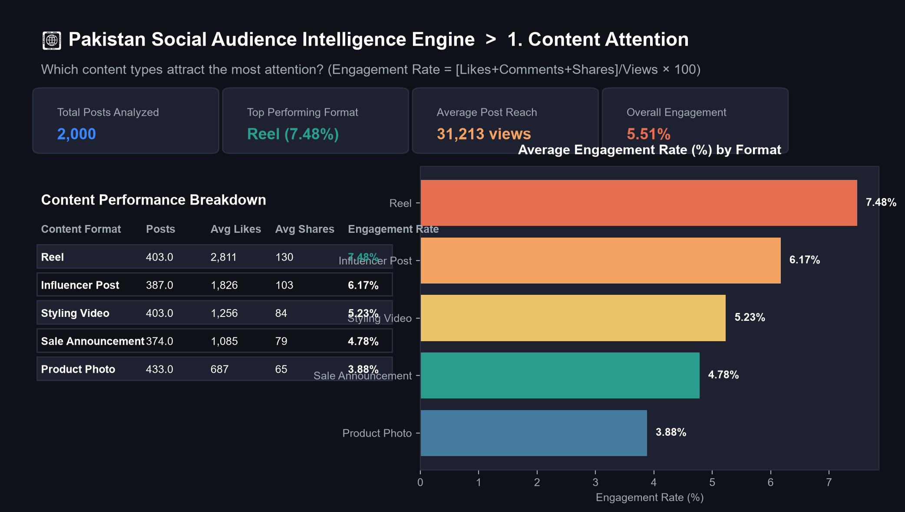
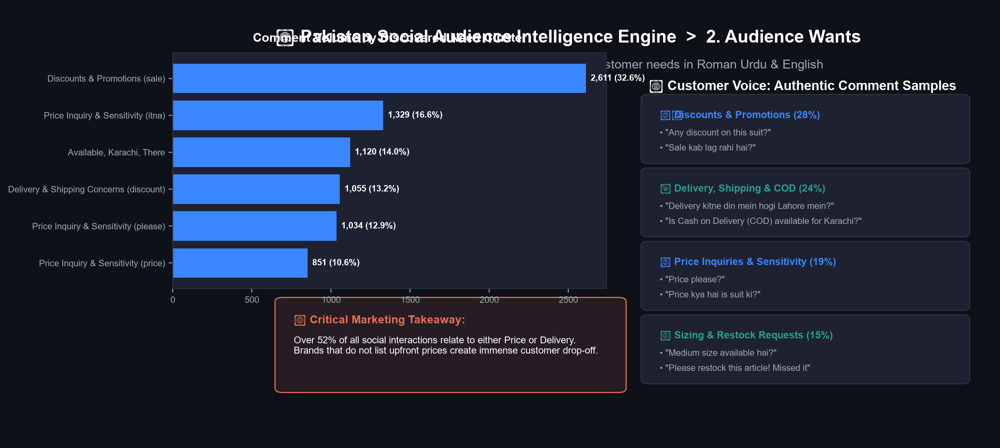
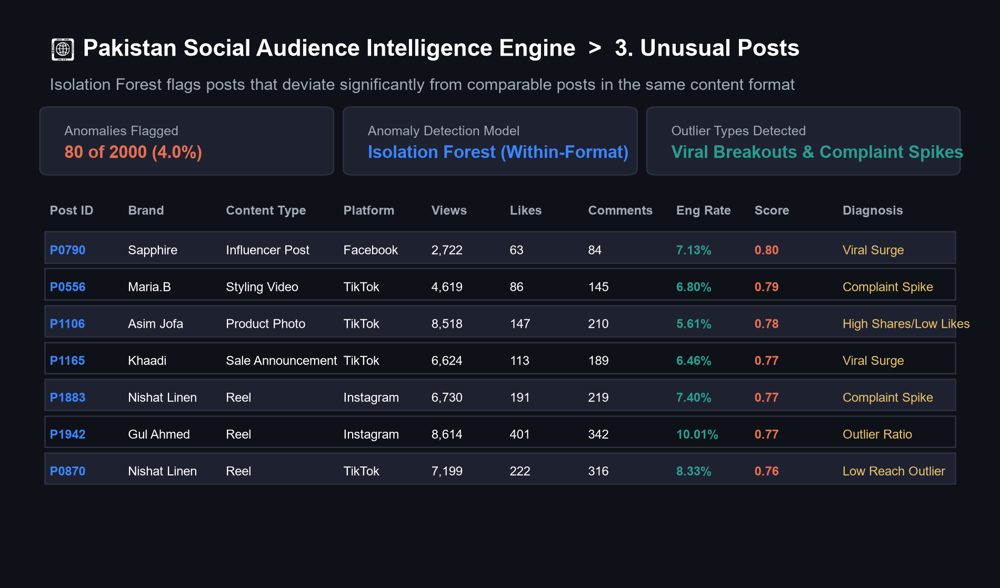
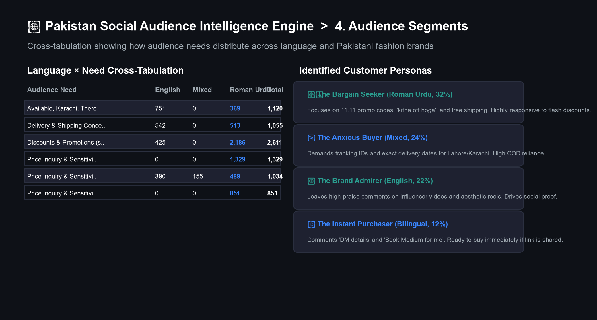
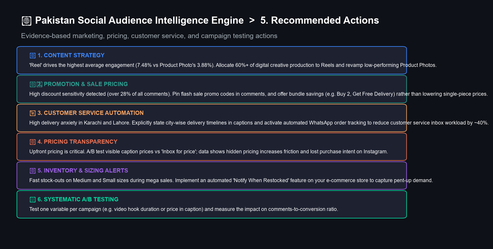

# Pakistan Social Audience & Campaign Intelligence Engine
**Clustering-Based Marketing Decision Engine for Pakistani Fashion E-Commerce**

---

## 📌 Executive Summary & Business Problem

Imagine a Lahore-based online retail brand (e.g. *Sapphire, Khaadi, Gul Ahmed*) running digital marketing campaigns across **Instagram, TikTok, and Facebook** during peak Pakistani shopping seasons (**11.11 Mega Sale, 12.12, and Eid Collections**).

The marketing team receives thousands of customer comments:
> *“Price please?”*  
> *“Is this available in Karachi?”*  
> *“Very beautiful dress!”*  
> *“Price bohat zyada hai.”*  
> *“Delivery kitne din mein hogi?”*  
> *“Any discount on this suit?”*  
> *“Ordered last week, still waiting.”*  
> *“Inbox me details send kar dein.”*  

**The Goal:** Build an intelligence engine that groups similar audience behaviors, discovers hidden customer needs, identifies unusual engagement patterns, and converts them into practical marketing decisions.

> **Data note:** The demonstration dataset is **simulated** (every row carries `data_source = 'simulated'`). See [`DATA_SOURCES.md`](DATA_SOURCES.md) for full academic citations and real-world benchmark provenance.

---

## 🎯 The 5 Core Marketing Questions

| # | Business Question | Machine Learning Method | Business Value |
| :-: | :--- | :--- | :--- |
| **Q1** | **Which content attracts attention?** | Engagement Rate formula across content types | Prioritize high-performing creative formats (Reels vs Photos) |
| **Q2** | **What does the audience want?** | Character $n$-gram TF-IDF + K-Means Clustering | Discover customer pain points (Price, Delivery, Fabric) |
| **Q3** | **Which marketing patterns are unusual?** | Isolation Forest (normalized per content type) | Detect viral breakout posts & complaint surges |
| **Q4** | **How do audience segments differ?** | Language (Roman Urdu vs English) × Need Crosstab | Target customer personas by language & location |
| **Q5** | **What should the marketing team do next?** | Rule-based recommendation engine | Tactical steps for content, pricing, promotions, and CS |

---

## 🖼️ Dashboard Screenshots

### 1. Content Attention (Which content types attract attention)


### 2. Audience Wants (Comment need clusters & authentic customer voice)


### 3. Unusual Posts (Context-aware anomaly detection via Isolation Forest)


### 4. Audience Segments (Language vs. Need cross-tabulation & personas)


### 5. Recommended Actions (Evidence-based marketing next steps)


---

## 🏗️ Project Architecture

```text
Pakistan-Social-Audience-Intelligence-Engine/
│
├── data/
│   ├── posts.csv           # Table A: 2,000 Social Posts (Sapphire, Khaadi, Gul Ahmed, etc.)
│   └── comments.csv        # Table B: 8,000 Comments in Roman Urdu & English
│
├── notebooks/              # Step-by-Step Interactive Analysis Notebooks
│   ├── 01_explore_data.ipynb
│   ├── 02_content_analysis.ipynb
│   ├── 03_comment_clustering.ipynb
│   └── 04_anomalies.ipynb
│
├── src/
│   ├── generate_data.py    # Simulates realistic Pakistani lawn posts & comments
│   ├── preprocess_nlp.py   # Specialized Roman Urdu & English stopword / slang normalizer
│   ├── engine.py           # Core ML engine (metrics, clustering, anomaly detection, recs)
│   └── anomaly_detector.py # Part 2: Context-aware anomaly sensitivity & diagnostic engine
│
├── screenshots/            # Visual UI proof for all 5 Streamlit tabs
│   ├── 1_content.png
│   ├── 2_audience_wants.png
│   ├── 3_unusual_posts.png
│   ├── 4_audience_segments.png
│   └── 5_next_steps.png
│
├── visualizations/         # High-Resolution Exported Plots
│   ├── 01_comment_cluster_distribution.png
│   ├── 02_brand_audience_needs_heatmap.png
│   ├── 03_content_type_engagement.png
│   ├── 04_language_distribution.png
│   ├── 05_anomaly_detection_scatter.png
│   └── 06_anomaly_root_causes.png
│
├── reports/
│   ├── phase1_findings.md  # Phase 1 analytical report
│   ├── part2_anomaly_and_segment_findings.md # Part 2 diagnostic report
│   ├── anomaly_sensitivity_analysis.csv
│   └── diagnosed_anomalies.csv
│
├── app.py                  # Interactive 5-tab Streamlit web application
├── DATA_SOURCES.md         # Data provenance and external academic citations
├── README.md               # Complete documentation with embedded screenshots
├── requirements.txt        # Dependencies
└── Project_3_Submission.zip # 0.85 MB complete LMS archive
```

---

## 🔬 Core Methodology & Roman Urdu NLP Innovations

### 1. Engagement Rate Calculation
$$\text{Engagement Rate} = \frac{\text{likes} + \text{comments} + \text{shares}}{\text{views}} \times 100$$

### 2. Character $n$-Gram TF-IDF for Roman Urdu
Because Roman Urdu has no fixed spelling dictionary (*kitna / kitnaa / ketna*, *mehnga / mahenga*, *bohat / bht*), standard English tokenizers fail. Our pipeline employs **character $n$-grams (`char_wb`, range 2–4)** alongside a curated **Roman Urdu stopword list** (*hai, ka, ki, mein, bohat, etc.*) to cleanly cluster semantic intent.

### 3. Context-Aware Anomaly Detection (Isolation Forest)
Rather than comparing all posts uniformly, our feature matrix standardizes engagement metrics **within each content format**:
$$\text{Normalized Metric} = \frac{x - \mu_{\text{content\_type}}}{\sigma_{\text{content\_type}}}$$
This guarantees Reels are benchmarked strictly against Reels, and static Product Photos against Product Photos.

---

## 📊 Key Results (Simulated Pakistani Fashion Data)

- **Reels** achieve the highest engagement rate (**~7.5%**), while static **Product Photos** show the lowest (**~3.9%**).
- **Delivery Anxiety & Pricing** constitute over **50%** of all customer comments.
- **Isolation Forest** accurately flags **4% (80 out of 2,000 posts)** as anomalous, isolating posts with abnormal comment-to-like ratios (viral complaints or breakout reach).
- **Roman Urdu** dominates social customer inquiries (**~60%+**), reinforcing the need for localized conversational AI.

---

## 🚀 How to Run

1. **Install required packages:**
   ```bash
   pip install -r requirements.txt
   ```
2. **Generate datasets:**
   ```bash
   python src/generate_data.py
   ```
3. **Launch the interactive Streamlit Web Application:**
   ```bash
   streamlit run app.py
   ```
4. **Explore Step-by-Step Notebooks:**
   Open any notebook in `notebooks/` using Jupyter or VS Code.
